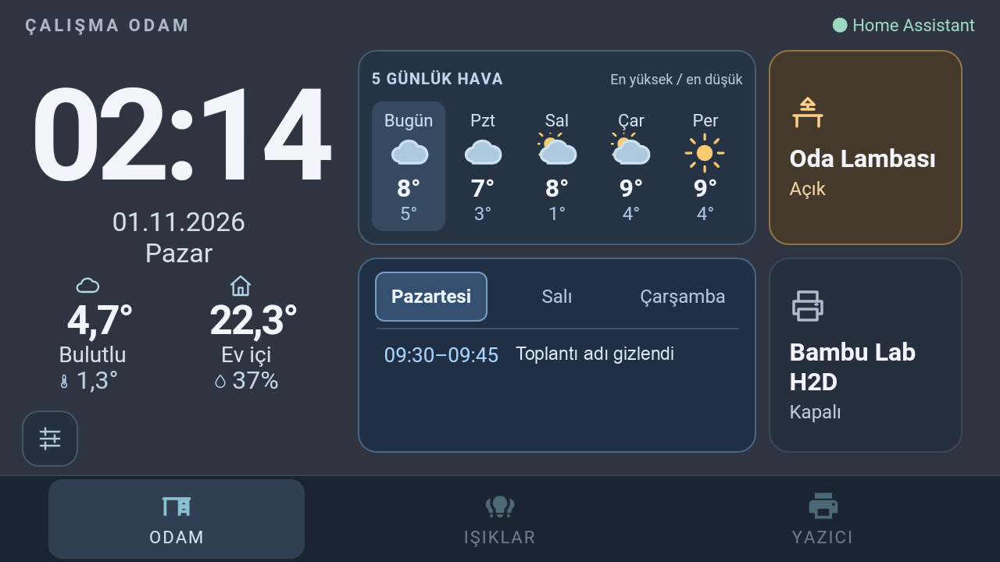

# Samsung landscape lock and DiagMonAgent — 2026-11-01

## Scope and rollback

Samsung SM-J510FN / Android 6 only. Denver's APK, settings and root helpers were
not changed. The previous Samsung APK was copied on-device before installation;
preferences and initial rotation settings were backed up privately.

Build 14's application orientation guard passed app relaunches but failed a real
reboot. Build 15 adds explicit landscape declarations to the Samsung startup and
browser activities; this alone also failed the subsequent real reboot. The
window token requested landscape (0), while Samsung's window policy retained
portrait (1), even with auto-rotation disabled and user rotation 1.

A controlled 30-second root orientation window changed SurfaceOrientation to 1;
removing it returned orientation 0. The final Samsung-only workaround uses a
transparent 1 × 1 system overlay requesting landscape. It has NOT_FOCUSABLE and
NOT_TOUCHABLE flags: it neither captures touches nor changes display power.
It holds the system orientation while running, including outside the panel.
It does not use sensors, timers or a polling loop. A local socket prevents a
second instance. The model/API guards reject anything except SM-J510FN/API 23.
No new application permission was requested. Denver is unchanged.

Build with `ANDROID_HOME` and JDK 8 using
`sh device-root/build-samsung-landscape-helper.sh`. Install the resulting
`samsung-landscape.jar` under `/data/local/tmp/`, then install
[`samsung-orientation-lock.sh`](../device-root/samsung-orientation-lock.sh) as
`/data/adb/service.d/89-samsung-orientation-lock.sh` with mode 755. Remove the
previous 92 orientation entry after privately backing it up. The boot entry
returns immediately, waits at most two minutes in its worker, restores rotation
settings, then starts the idle helper; it cannot block later service.d entries.

Rollback: remove only the 89 entry, terminate the matching
`com.thanksmister.iot.wallpanellegacy.root.SamsungLandscapeGuard` process, and
restore the previous rotation settings/APK if desired. Termination automatically
removes the orientation window. Existing Wi-Fi ADB and display helpers are not
modified. The helper's memory footprint on this device was about 46 MB RSS;
its main loop waits for events rather than polling.

DiagMonAgent was identified as `com.sec.android.diagmonagent`, version 4.1.15,
in the system's `priv-app` directory. User 0 now has `enabled=3` (disabled-user)
and the package is stopped. A normal shell disable was rejected because this
package uses the system UID; the existing authorized root access applied the
package-specific change. The APK/system partition was not removed or rewritten.

To undo the diagnostic-package change, run `pm enable --user 0
com.sec.android.diagmonagent` under root. To undo the orientation configuration,
remove only the new boot script and restore the privately recorded Android
rotation settings; the previous APK can be installed back without clearing data.
Do not copy these changes to Denver or disable unrelated system packages.

## Acceptance record

The user restarted the batteryless phone after the final orientation helper
was installed and confirmed that it opened correctly in landscape. This verifies
the reported orientation symptom, not every post-boot feature. Full device acceptance remains PENDING until every
applicable item in the mandatory checklist has physical evidence.

| ID | Status | Evidence / remaining check |
| --- | --- | --- |
| D01 | PENDING | Final helper: user confirmed actual reboot opened correctly. Touch/lock acceptance still pending. |
| D02 | PENDING | Not repeated on this installed revision; previous behavior is not full acceptance. |
| D03 | PENDING | Not repeated on this installed revision; previous behavior is not full acceptance. |
| D04 | PENDING | Not repeated on this installed revision; previous behavior is not full acceptance. |
| D05 | PENDING | Not repeated on this installed revision; previous behavior is not full acceptance. |
| D06 | PENDING | Not repeated on this installed revision; previous behavior is not full acceptance. |
| D07 | PENDING | Not repeated on this installed revision; previous behavior is not full acceptance. |
| D08 | PENDING | Not repeated on this installed revision; previous behavior is not full acceptance. |
| D09 | N/A | The office phone does not configure a native battery overlay. |
| D10 | N/A | The office phone does not configure a native battery overlay. |
| D11 | PENDING | Not repeated on this installed revision; previous behavior is not full acceptance. |
| D12 | PENDING | Actual user reboot opened correctly; post-boot timeout/wake/power/first-tap checks pending. |
| D13 | PENDING | Not repeated on this installed revision; previous behavior is not full acceptance. |
| D14 | PENDING | Preference backup retained; final Build 15 post-boot comparison pending. |
| U01 | N/A | Samsung uses the separate office layout rather than the Denver Home reference. |
| U02 | PENDING | Not repeated on this installed revision; previous behavior is not full acceptance. |
| U03 | PENDING | Not repeated on this installed revision; previous behavior is not full acceptance. |
| U04 | PENDING | Not repeated on this installed revision; previous behavior is not full acceptance. |
| U05 | PENDING | Not repeated on this installed revision; previous behavior is not full acceptance. |
| U06 | PENDING | Not repeated on this installed revision; previous behavior is not full acceptance. |
| U07 | PENDING | Not repeated on this installed revision; previous behavior is not full acceptance. |
| H01 | N/A | Samsung uses the separate office layout rather than the Denver Home reference. |
| H02 | PENDING | Not repeated on this installed revision; previous behavior is not full acceptance. |
| H03 | PENDING | Not repeated on this installed revision; previous behavior is not full acceptance. |
| H04 | PENDING | Not repeated on this installed revision; previous behavior is not full acceptance. |
| H05 | PENDING | Not repeated on this installed revision; previous behavior is not full acceptance. |
| H06 | PENDING | Not repeated on this installed revision; previous behavior is not full acceptance. |
| H07 | N/A | Robot controls are absent from this office profile. |
| H08 | PENDING | Not repeated on this installed revision; previous behavior is not full acceptance. |
| H09 | PENDING | Not repeated on this installed revision; previous behavior is not full acceptance. |
| H10 | PENDING | Not repeated on this installed revision; previous behavior is not full acceptance. |
| E01 | PASS | Clean Samsung flavor debug build passed under JDK 8 with offline dependencies; shell syntax check passed. |
| E02 | PASS | Build 15 alone failed real boot; final orientation helper returned SurfaceOrientation=1. User confirmed final helper opened correctly after real reboot. |
| E03 | PASS | Only the orientation changes and guide are selected; private configuration and unrelated working-tree changes excluded. |
| E04 | PASS | Only intended orientation helper/script/guide selected; all remaining physical checks explicitly PENDING. |

Build 14 and manifest-only Build 15 both failed actual boot tests; their relaunch evidence must not be used as reboot acceptance.
DiagMonAgent remained disabled-user/stopped after both. Home and settings opened
in landscape; the wider complete physical-feature gate remains PENDING.

Work-title pixels were covered with a flat neutral label before publication.
